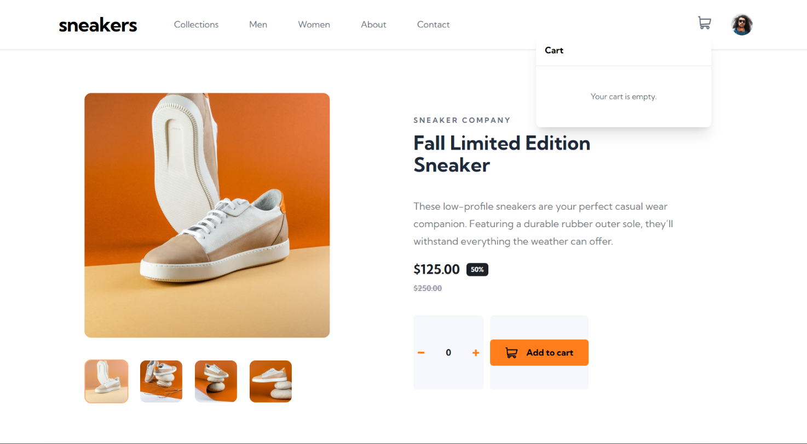
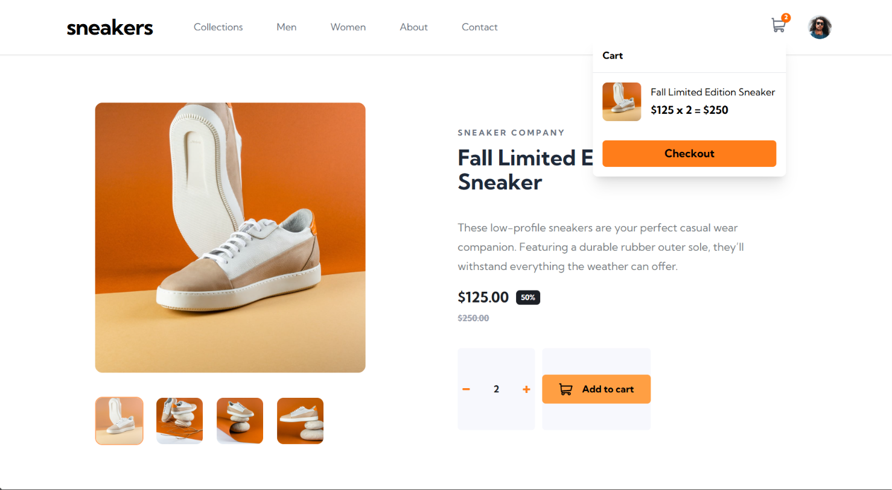
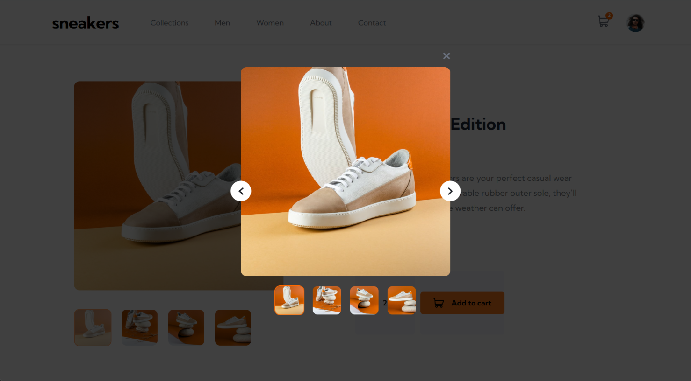
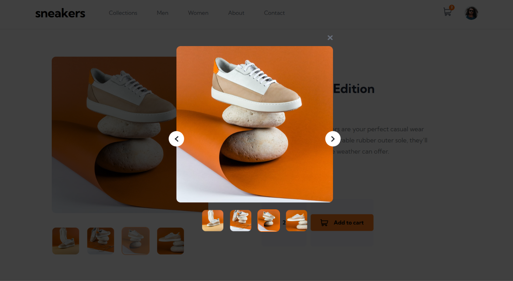
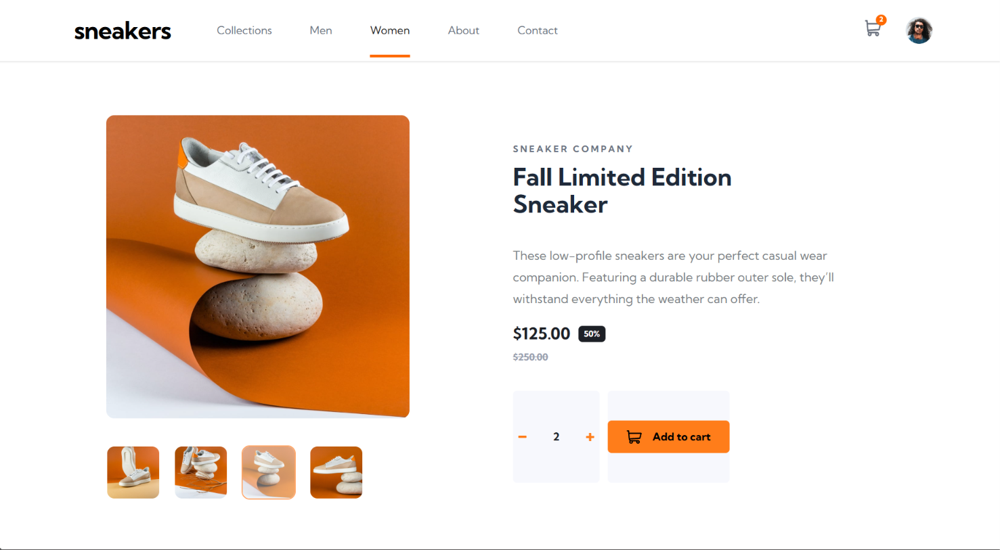
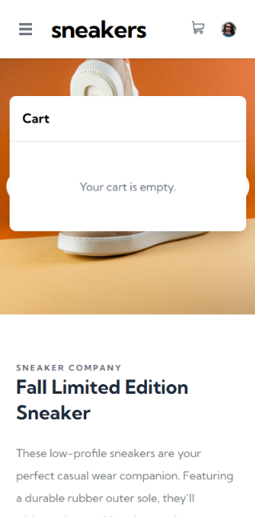
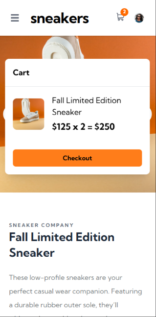
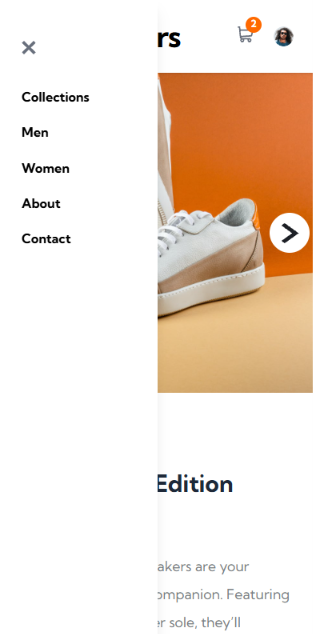

# E-commerce product page Solution

This is the solution to the [E-commerce product page challenge on Frontend Mentor](https://www.frontendmentor.io/challenges/ecommerce-product-page-UPsZ9MJp6).

## Table of contents

## Overview

### The challenge

Users should be able to:

- View the optimal layout for the site depending on their device's screen size
- See hover states for all interactive elements on the page
- Open a lightbox gallery by clicking on the large product image
- Switch the large product image by clicking on the small thumbnail images
- Add items to the cart
- View the cart and remove items from it

## ScreenShot
 
 ### for desktop

### for mobile

### Links

- Solution URL: https://github.com/RISHABH-cyber-blip/self-learning-react-shoe-cart
- Live Site URL: https://rishabh-cyber-blip.github.io/self-learning-react-shoe-cart/

## My process

### Built with